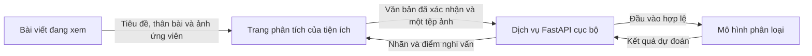
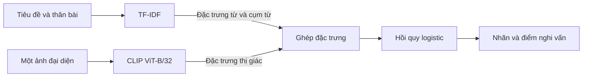
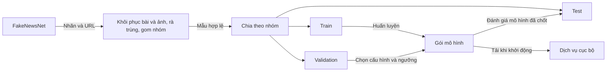

# Thiết kế kiến trúc · Phát hiện tin giả từ bài viết và ảnh

Kiến trúc gồm tiện ích Chromium, dịch vụ FastAPI trên máy cá nhân và mô hình phân loại. Dịch vụ tải sẵn bộ mã hóa ảnh và bộ phân loại khi khởi động. Demo suy luận trên CPU.

## 1. Luồng dữ liệu khi phân tích bài

1. Tiện ích trích tiêu đề, thân bài và ảnh ứng viên từ bài đang xem.
2. Người dùng sửa nội dung và xác nhận một ảnh trước khi gửi.
3. Dịch vụ cục bộ kiểm tra văn bản và tệp ảnh, sau đó gọi mô hình.
4. Trang phân tích hiển thị nhãn dự đoán và điểm nghi vấn do dịch vụ trả về.

Nếu trang hoặc ảnh bị chặn, người dùng có thể dán thân bài và tải ảnh từ máy. Tiện ích giữ bản nhập khi dịch vụ gặp lỗi.

## 2. Hai nhánh đặc trưng hội tụ

TF-IDF biểu diễn các từ và cụm từ trong tiêu đề và thân bài. CLIP ViT-B/32 mã hóa ảnh thành đặc trưng thị giác. Mô hình nối hai nhóm đặc trưng và dùng hồi quy logistic để tính điểm nghi vấn, sau đó áp dụng ngưỡng để dự đoán nhãn.

## 3. Luồng dữ liệu huấn luyện

Mục tiêu là 200–500 bài hợp lệ từ FakeNewsNet. Ưu tiên PolitiFact và bổ sung GossipCop khi cần. Mỗi mẫu phải có nhãn, thân bài và ảnh đọc được. Rà trùng và gom bài cùng sự kiện trước khi chia theo nhóm để chúng nằm trong cùng một tập.

Gói mô hình chứa bộ tạo đặc trưng, bộ phân loại và ngưỡng đã chọn. Dịch vụ cục bộ dùng gói này để xử lý bài mới.

## 4. Các cấu hình đối chứng

| Cấu hình | Đầu vào mô hình | Vai trò |
| --- | --- | --- |
| Chỉ văn bản | Đặc trưng TF-IDF | Mốc đối chiếu |
| Chỉ ảnh | Đặc trưng CLIP | Đo tín hiệu từ ảnh |
| Kết hợp | Đặc trưng TF-IDF và CLIP | Đo thay đổi khi thêm ảnh |

Cả ba cấu hình dùng hồi quy logistic và cùng tập chia. Demo dùng cấu hình kết hợp.

Nội dung này tương ứng với trang 3–6 của [bài trình bày](slides/index.html#03). Phạm vi đề tài nằm trong [DEFINE.md](DEFINE.md).

## Đối chiếu bản đóng gói ngày 26/11/2026

Bản unpacked dùng popup và tự chọn ảnh hợp lệ đầu tiên. Flow màn hình phân
tích ở §1 vẫn là thiết kế dùng để đối chiếu nhập/sửa/chọn thủ công.
Backend đã có chế độ production với warm-up và kiểm hash metadata. ML đã chạy Test cuối sau khi merge freeze đủ chữ ký.
QA tái tính metrics từ predictions đã lưu và chờ ML review. [Sơ đồ bản đang nghiệm thu](DIAGRAMS.md) · [Bằng chứng QA](reports/final-report.md)
