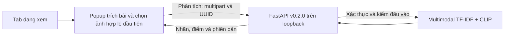
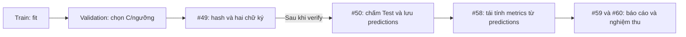

# Sơ đồ đối chiếu bản tích hợp

Mã nguồn ngày 26/11/2026. [Thiết kế](DESIGN.md) · [Ma trận nghiệm thu](reports/final-report.md)

## Suy luận từ Extension

Gói unpacked dùng popup. Luồng sửa nội dung và chọn/tải ảnh thủ công đang
chờ xác nhận theo [#43](reports/e2e-real-model.md).

## Train, freeze và Test

Hồ sơ đã có cả hai chữ ký. QA tái tính từ predictions và khớp metrics của ML.
[Bằng chứng #58](reports/evaluation-audit.md) · [Biên bản trước Test](reports/pre-test-signoff.md)
